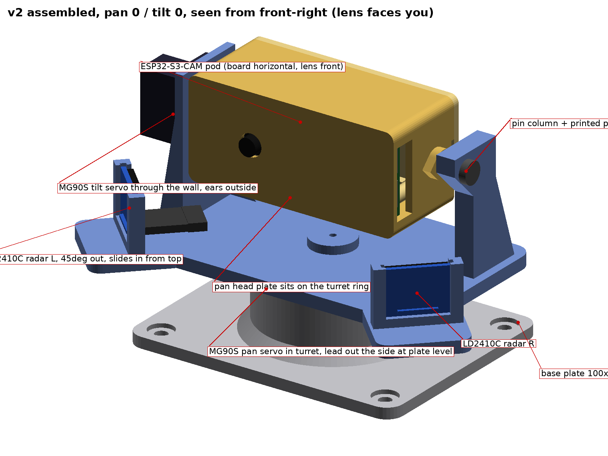
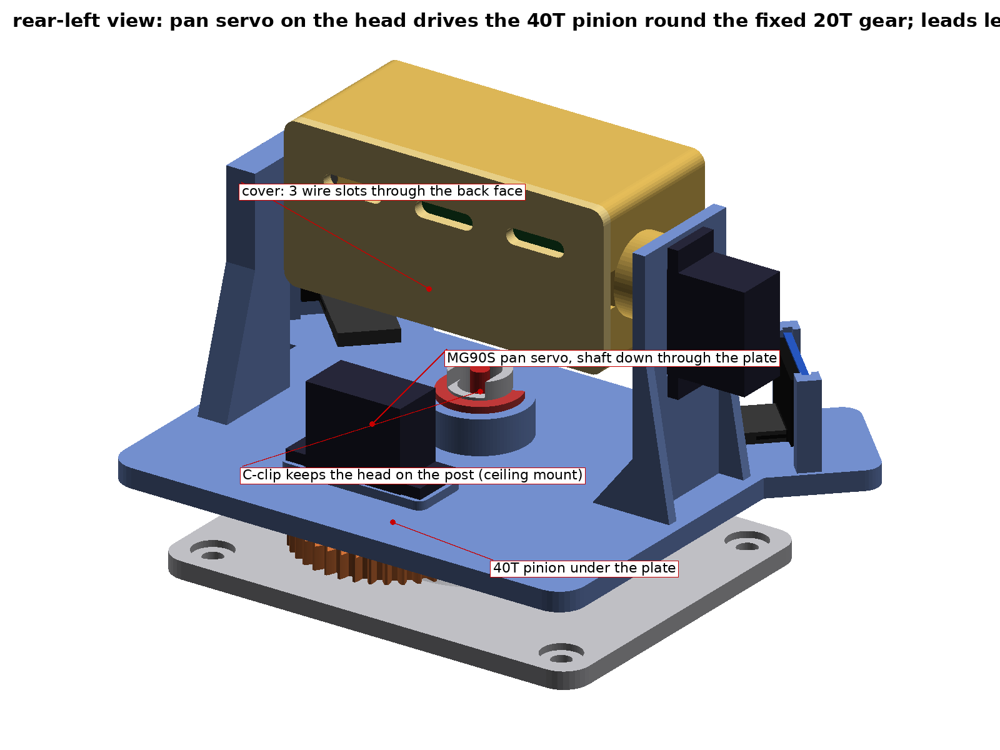
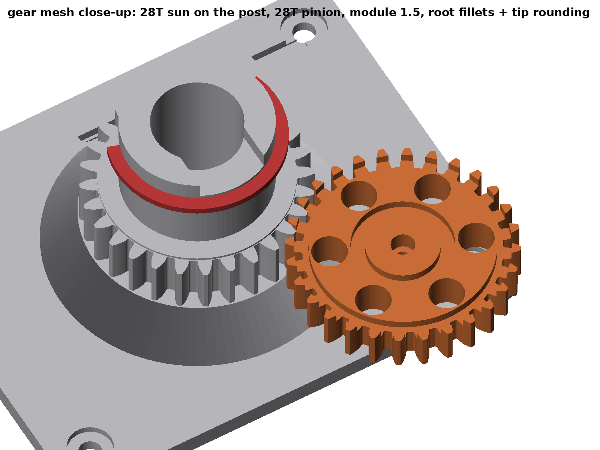
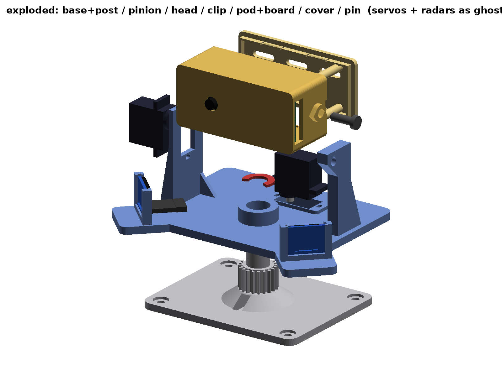
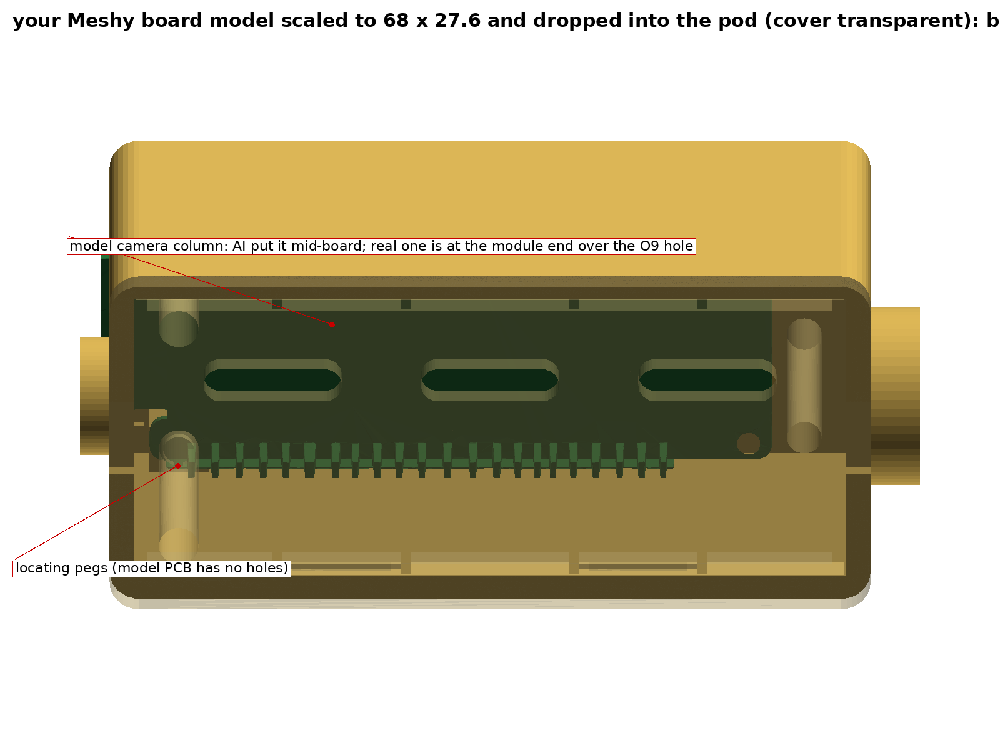

# Pan/tilt camera head v2.2 — ESP32-S3-CAM + 2× MG90S + 2× HLK-LD2410C, 360° pan on a hollow post, all printed

No STM32 box, no bought bearings, no extra hardware: seven printed parts, two MG90S with their
kit screws, two LD2410C, the ESP32-S3-CAM board, jumper wires and a 5 V lead.

- **Base**: a plate with a fixed **Ø30 hollow post** (Ø18 bore — a USB-C plug fits through it) that
  carries a fixed 28-tooth sun gear and a flat thrust ring on top of it.
- **Pan head**: rides on the post as a 12.5 mm long journal bearing, its weight sits on the flat ring.
  It carries the **pan servo**, whose 28-tooth pinion walks round the fixed sun gear (planetary
  arrangement, 1:1), the tilt servo, the pivot column and the two radar holders at ±45°. A printed
  C-clip keeps it on the post.
- **Pod**: the ESP32-S3-CAM lies along the tilt axis; every lead leaves through three slots in the
  back cover, behind the swing.

Print file: **`out/pantilt_cam_v2_A1mini.3mf`** (Bambu Studio, two A1 mini plates, no supports).
`out/*.stl` are the parts as modelled, `out/*_print_oriented.stl` the same parts laid flat, and
`out/pantilt_cam_v2_generic.3mf` is a plain 3MF for other slicers.






## What's in the 3MF

| plate | part | print orientation | notes |
|---|---|---|---|
| 1 | 1 Base plate + hollow post | as is | 100 × 80 × 4 plate, 4× Ø4.5 holes with Ø9 counterbores (M4 / #8 screws). Ø30 post, Ø18 bore, 28T module-1.5 sun gear, thrust ring, C-clip groove, wire slot at the top, 13 × 7.5 cable notch at the foot |
| 1 | 3 Camera pod | lens face down | 77 × 36 × 35 box, ESP32-S3-CAM lies inside, lens looks out the front |
| 1 | 4 Pod back cover | outer face down | snap tabs top/bottom, pry notches at both ends, three 14 × 3.6 wire slots through the back face |
| 1 | 6 Pan pinion 28T | screw side down | module 1.5, Ø45, 8 mm thick, Ø4.7 spline socket on top, screw-head recess underneath, grooves for the ear-screw tips |
| 1 | 5 Pivot pin | standing on its head | Ø6 × 14 shank. Print 2–3 |
| 1 | 7 Post C-clip | flat | Ø35, snaps sideways into the Ø27 groove. Print 2–3 |
| 2 | 2 Pan head | plate down | yoke plate + Ø36 hub + pan-servo pad/window + tilt-servo wall + pin column + two LD2410C holders |

Settings: **0.2 mm layers, 0.4 nozzle, 3–4 walls, 20 % infill, PLA or (better for the gears) PETG,
no supports.** Bridges are short (13 mm cable slot, 13 mm servo window, 25 mm USB opening); every
horizontal hole is a teardrop. Brim on the pan head and the pinion.

Validation (`check_v2.py`, `out/check_report.txt`): every part is a closed manifold; no part
touches another in the assembled position; the pinion meshes with the sun at every pan angle with
0.18 mm minimum tooth clearance; the pod clears the plate, the post and the radar holders at every
tilt angle from −90° to +90°; a USB-C plug passes the post bore; everything is inside the 180 × 180
bed.


## Fit check against the user's board model

`out/fig14_meshy_board_fit.png`: the Meshy-generated ESP32 camera board model, scaled to the real
68 × 27.6 mm footprint and placed in the pod where the board goes (component side to the front wall,
USB end at the end-wall opening). PCB body, header pins and ports clear the pod and cover. The only
contacts are artefacts of the AI model: its camera column sits mid-board (the real OV3660 sits on the
module end, over the Ø9 lens hole), its PCB has no mounting holes (the pegs pass through solid
plastic) and its header rows run 8 mm longer than the real board's (they graze a cover post).



## Why these gears

- **Module 1.5, 28 teeth each**, 20° involute, standard full-depth tooth (addendum 1.5, dedendum
  1.875), 0.45 mm root fillets, 0.2 mm tip rounding, 0.15 mm backlash per gear, centre distance
  42.0 + 0.1 for printing. A tooth is 2.2 mm thick at the pitch line and 0.9 mm wide at the tip, which
  a 0.4 nozzle prints cleanly (five perimeters across a tooth). 28 teeth at 20° have no undercut.
- **1:1**: the head turns degree-for-degree with the servo. A 360°-range positional servo gives 360°
  of pan; an ordinary 180° one gives 180°; a continuous-rotation one turns it at servo speed (see the
  servo note). The pinion's angle is the head's angle, so an encoder on the pinion would read the
  head directly if you ever add one.
- **Journal, not a spline**: the head's Ø30.4 bore runs on the Ø30 post over 12.5 mm, and its weight
  sits on a 4 mm wide flat ring at Ø30–38. Contact pressure is a few kPa; PLA on PLA at a few
  turns an hour does not wear. Put a smear of silicone grease or PTFE lube on the post and the ring.
- The pinion hangs on the servo spline (Ø4.7 socket, 2.9 mm engagement, kit centre screw from below)
  and is kept at the right height by the servo's ears on the 2 mm pad. Nothing else touches it.

## Bill of materials

- 1× ESP32-S3-CAM (the 68 × 29 mm dual USB-C board, OV3660 on the 21 mm ribbon)
- 2× MG90S (SG90 footprint) with their kit screws (2 ear screws + 1 centre screw each)
- 2× HLK-LD2410C with the 5-pin header soldered (pins on the component side)
- female–female Dupont jumpers: 4–5 per radar (VCC, GND, TX, RX, OUT), 2 for power, 3 per servo if a lead needs extending
- power: either the USB-C cable itself, fed up through the post into the OTG port, or a cut cable /
  5 V adapter lead to the board's 5V and GND pins (2 A; the servos can pull over 1 A when they stall)
- 4× M4 (or #8 wood) screws for the base plate
- foam tape or a 1 mm thermal pad for the ESP32 module, hot glue for the camera head, a cable tie
- optional: a reed switch + Ø8 × 5 magnet for pan homing (pockets are there)

## How it goes together

1. **Power lead into the base.** Feed it in through the notch at the foot of the post (a USB-C plug
   fits) or up through the hole under the post, and out of the top. Leave ~120 mm sticking out of
   the top for the twist. Tie it off at the notch.
2. **Pan servo onto the head.** Drop the MG90S into the window in the raised pad at the back-left of
   the head, shaft **down**, ears on the pad, two ear screws into the slotted pilot holes. Press the
   pinion onto the spline from below (ream the Ø4.7 socket to 4.8 if it is really tight) and put the
   centre screw up through the pinion from underneath.
3. **Head onto the post.** Grease the post and the ring. Set the servo to its centre, lower the head
   over the post with the pinion teeth entering the sun gear — any tooth; to re-seat "forward", lift
   the head and drop it back one tooth over (12.9° per tooth). Snap the C-clip into the groove just
   above the hub, from the side.
4. **Radars.** Each LD2410C slides down into its holder from the top, antenna side (the two square
   copper patches) facing **out**, header edge at the **bottom**, so the Dupont housings lie flat on the
   plate pointing back towards the middle. Put a drop of hot glue on the top edge: nothing else holds
   the board in if the unit is mounted upside down or gets knocked.
5. **Board into the pod.** Stick the camera head onto the ESP32 module can with foam tape so the lens
   barrel goes through the Ø8 hole in the front wall (9.4 × 9.4 recess for the square head). Board in
   with the component side towards the front wall (module against the wall, thermal pad there),
   USB-C ports facing the opening in the end wall, header pins towards the cover. Plug the leads on,
   pass the free ends out through the three slots in the cover's back face, snap the cover on (pry it
   off at the end notches).
6. **Pod onto the head.** Lower the pod between the wall and the column with the big boss on the
   wall side. Push the pivot pin through the column into the small boss on the pod's USB end.
7. **Tilt servo last, from outside.** Slide the MG90S through the window in the wall, shaft first, so
   its spline enters the pod's socket; two ear screws into the slotted pilot holes. Its centre screw
   goes in from *inside the pod* through the Ø2.3 hole in the end wall (do it before the cover goes on
   for the last time, or skip it — the press fit plus the pin on the other side hold the pod).
8. Screw the base plate down, connect the lead, done.

## Wiring

Everything plugs onto the ESP32-S3-CAM's header pins on the back of the board, and all of it rides
on the head, so only the power crosses the pan joint, through the post:

- Power: either the USB-C cable through the post into the OTG port, or 5 V/GND onto the board's
  **5V** and **GND** pins (this also powers both servos and both radars through the pins).
- Pan servo (on the head, next to the hub): brown → GND, red → 5V, orange → a PWM GPIO.
- Tilt servo (out of the top of the servo on the left wall): same, second PWM GPIO.
- Each LD2410C: VCC → 5V, GND → GND, TX → an ESP32 RX pin, RX → an ESP32 TX pin (256000 baud), or
  just OUT → a GPIO if you only need "someone is there".
- Which GPIOs are free depends on the camera pin map (`camera_pins.h` in the repo for the DVP pins
  to avoid). G1, G2, G21, G47, G14, G13 are the usual candidates; G19/G20 are the native USB pair.

## Motion

- **Pan**: 1:1. The head turns once; the lead twists once inside the post, which a flexible cable
  does without complaint. Keep the pan to ±180° from home in firmware so the lead never winds up.
- **Tilt**: the pod clears everything fixed at every angle. With a USB-C cable in the pod's end
  port, looking **down** is limited to about +60° before the plug touches the pivot column.
- Head wobble is set by the 0.2 mm journal clearance over 12.5 mm: about 0.1 mm at the lens.

## About the "360°" MG90S

A micro servo sold as "360°" is almost always *continuous rotation*: the pulse sets speed and
direction, not position. For the **tilt** you need a positional servo full stop. For the **pan**,
a continuous servo works with this mechanism (it just spins the head at servo speed through the
1:1 gears) if you add a home reference and keep count: the head has a Ø8 × 5 magnet pocket in its
underside at the front and the base has a reed-switch slot under it; home on the switch, then time
the moves and stay inside ±180°. Positional servos are the easy path: a 360°-range one gives a full
turn directly, a 180° one gives half.

## Regenerating / changing dimensions

Everything comes from `gen_pantilt_v2.py` (one parameter dict `P` at the top).

```
pip install manifold3d trimesh shapely scipy numpy pillow lxml
python3 gen_pantilt_v2.py    # STLs in out/
python3 check_v2.py          # interference, component clearance, pan + tilt sweeps, overhang report
python3 render_v2.py         # figures
python3 pack_3mf.py          # Bambu 3MF (A1 mini) + generic 3MF + print-oriented STLs
```

| what | value |
|---|---|
| servo pocket / window | 23.4 × 12.9 (MG90S case 22.8 × 12.2); ear pilots 1.8 × 2.4 slots on 28.0 mm centres |
| spline sockets | Ø4.7, 5 deep (pod) / 4 deep (pinion), Ø2.3 centre-screw hole |
| pan gears | module 1.5, 28T/28T, 20°, centre distance 42.1, backlash 0.15/gear, face width 10.5 (sun) / 8 (pinion) |
| post / journal | Ø30 post, Ø18 bore, head bore Ø30.4, 12.5 mm long, thrust ring Ø30–38, C-clip groove Ø27 |
| tilt axis | 48 mm above the head plate top, 5 mm behind the pod's depth centre |
| pod cavity | 72 × 31 × 29.5 (board 68 × 29 incl. module overhang, 24 mm behind the PCB for Dupont housings) |
| radar holder grooves | 2.0 mm wide, 1.2 mm deep each side (PCB 1.0–1.6) |
| pivot pin | Ø6 in a Ø6.1 column hole (friction) and Ø6.4 pod hole (free) |
